# 🌤️ WearMet

> Aplicación Android de previsión meteorológica con widget de pantalla de inicio, hecha 100 % en Kotlin y Jetpack Compose. Disponible en **español** e **inglés**.

<p align="center">
  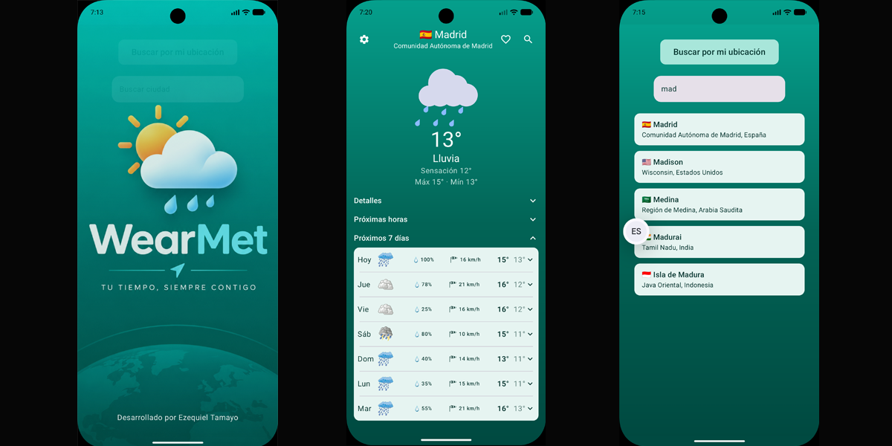
</p>

---

## 📑 Índice

- [🌤️ WearMet](#️-wearmet)
  - [📑 Índice](#-índice)
  - [✨ Características](#-características)
  - [📸 Capturas de pantalla](#-capturas-de-pantalla)
    - [Flujo principal](#flujo-principal)
    - [Pantalla del tiempo](#pantalla-del-tiempo)
    - [Ajustes, tema e idiomas](#ajustes-tema-e-idiomas)
  - [🧩 Widget](#-widget)
  - [🌐 Idiomas](#-idiomas)
  - [🛠️ Tecnologías](#️-tecnologías)
  - [🏗️ Arquitectura](#️-arquitectura)
  - [🌍 Fuente de datos y créditos](#-fuente-de-datos-y-créditos)
  - [🎨 Créditos de recursos gráficos](#-créditos-de-recursos-gráficos)
    - [Animaciones (Lottie)](#animaciones-lottie)
    - [Iconos e imágenes](#iconos-e-imágenes)
  - [🚀 Instalación y compilación](#-instalación-y-compilación)
    - [Requisitos](#requisitos)
    - [Pasos](#pasos)
    - [Probar la versión directamente](#probar-la-versión-directamente)
    - [Generar una versión release](#generar-una-versión-release)
  - [🔐 Permisos](#-permisos)
  - [📂 Estructura del proyecto](#-estructura-del-proyecto)
  - [📜 Licencia](#-licencia)
  - [👤 Autor](#-autor)

---

## ✨ Características

- **Búsqueda de ciudades** con espera de 400 ms al escribir (debounce) y a partir de 3 letras. Muestra hasta 5 resultados con bandera, región y país.
- **Mi ubicación** mediante GPS (Fused Location), con comprobación de ajustes de ubicación y geocodificación inversa para obtener el nombre del lugar.
- **Favoritos** guardados en local con Room, accesibles desde la pantalla de búsqueda.
- **Tiempo actual**: temperatura, sensación térmica, máxima y mínima del día y animación Lottie según la condición (día y noche).
- **Detalles**: viento y rachas con flecha de dirección, precipitación, presión, nubosidad, índice UV, humedad, amanecer y atardecer.
- **Previsión por horas** (24 h) con la hora actual resaltada y iconos de día o noche.
- **Previsión a 7 días** con probabilidad de lluvia, viento máximo y temperaturas. Cada día se expande para ver sus horas.
- **Widget de pantalla de inicio** con Jetpack Glance, caché sin conexión y actualización periódica.
- **Ajustes**: pantalla de bienvenida (activar y duración de 1 o 2 s), abrir directamente la localidad preferida, localidad del widget e intervalo de actualización (1, 3, 6 o 12 h).
- **Tema claro y oscuro** automático según el sistema.
- **Dos idiomas** (español e inglés), según el idioma del dispositivo.
- **Gestión de errores** con mensajes claros (sin conexión, error del servidor, sin resultados) y botón de reintentar.

---

## 📸 Capturas de pantalla

### Flujo principal

|                                       Bienvenida                                       |                                      Búsqueda                                      |                                     Favoritos                                     |
| :------------------------------------------------------------------------------------: | :--------------------------------------------------------------------------------: | :-------------------------------------------------------------------------------: |
| 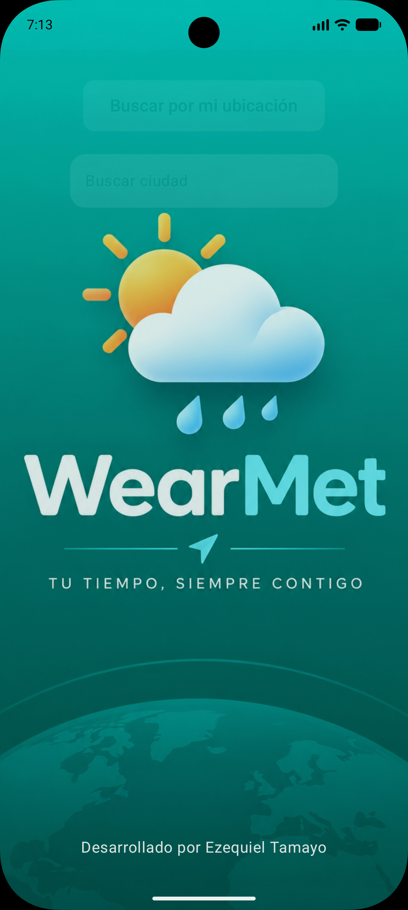 | 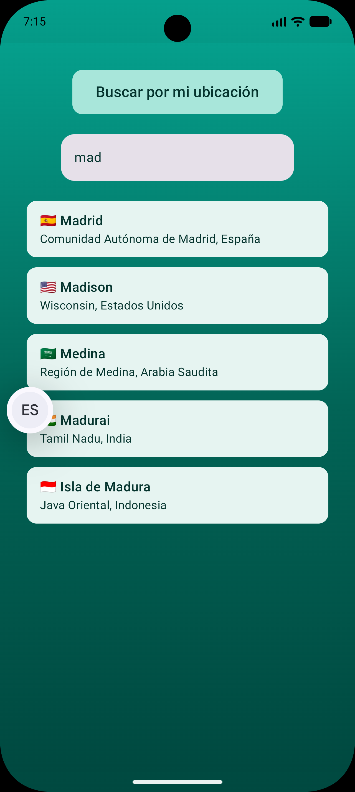 | 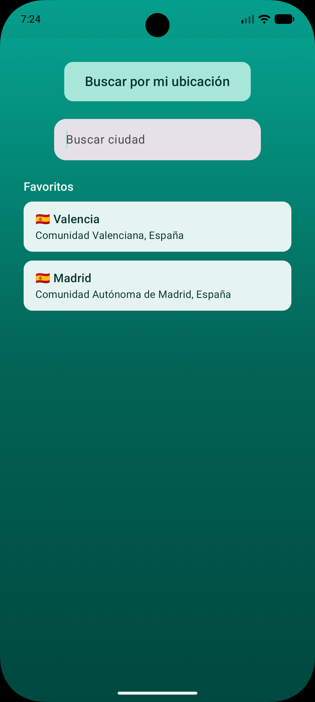 |
|                                 *Splash configurable*                                  |                              *Resultados al escribir*                              |                              *Ubicaciones guardadas*                              |

### Pantalla del tiempo

|                                  Tiempo actual                                   |                                         Detalles                                         |                                       Por horas                                       |                                      Por días                                       |
| :------------------------------------------------------------------------------: | :--------------------------------------------------------------------------------------: | :-----------------------------------------------------------------------------------: | :---------------------------------------------------------------------------------: |
| 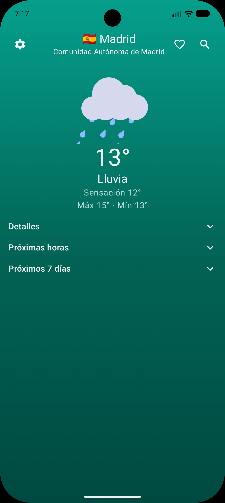 | 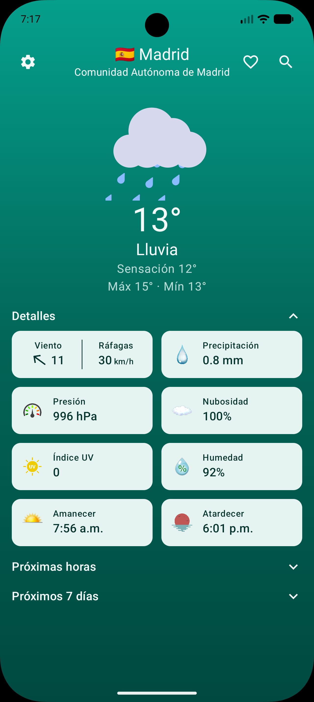 | 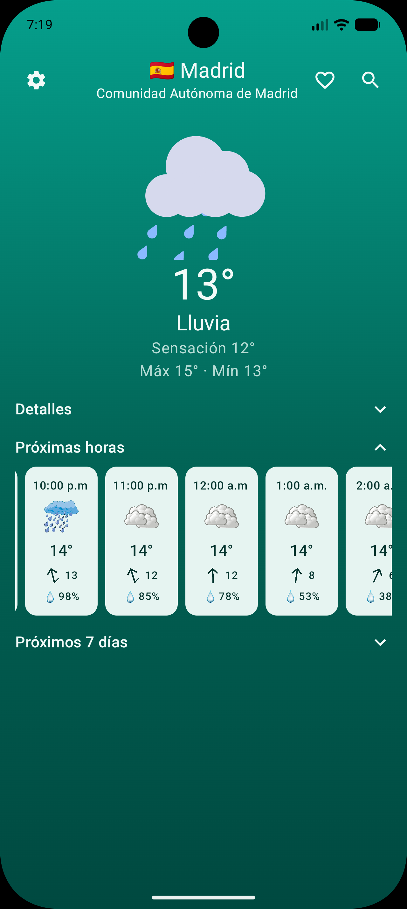 | 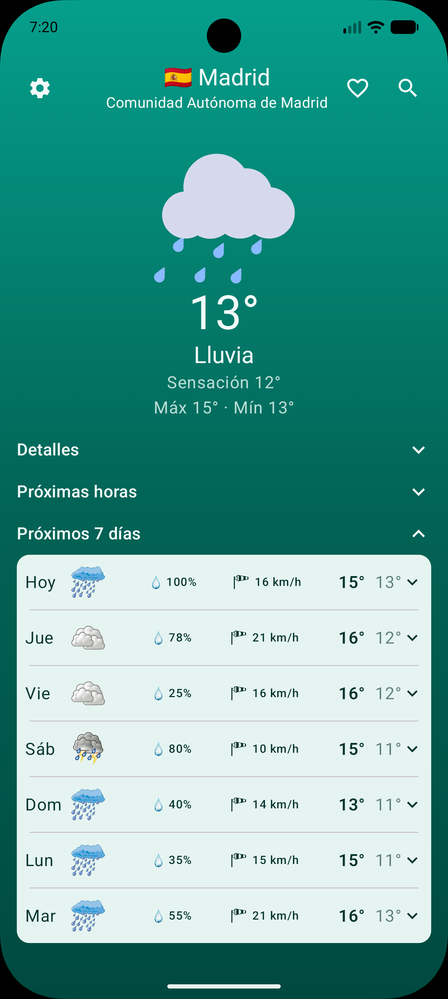 |

### Ajustes, tema e idiomas

|                               Ajustes                                |                                 Modo claro                                 |                                 Modo oscuro                                  |
| :------------------------------------------------------------------: | :------------------------------------------------------------------------: | :--------------------------------------------------------------------------: |
| 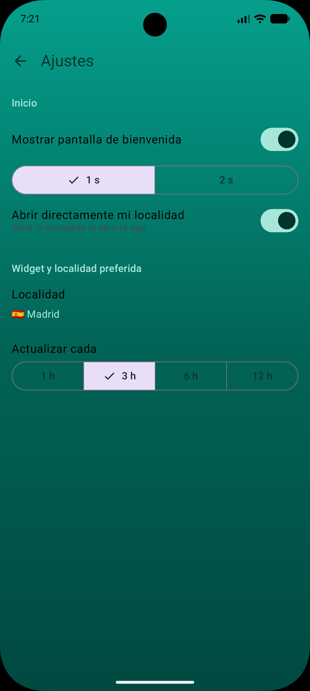 | 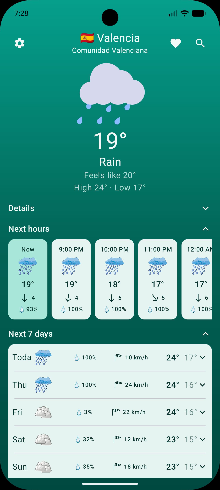 | 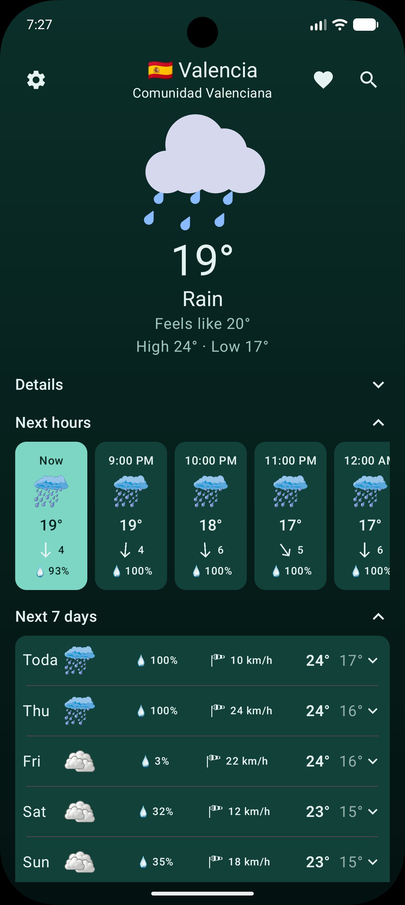 |

|                                   Español                                   |                                  English                                   |
| :-------------------------------------------------------------------------: | :------------------------------------------------------------------------: |
| 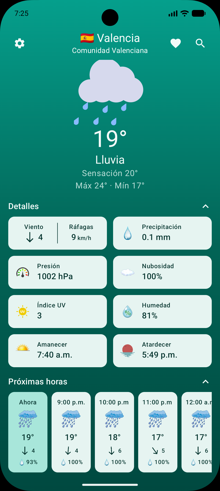 | 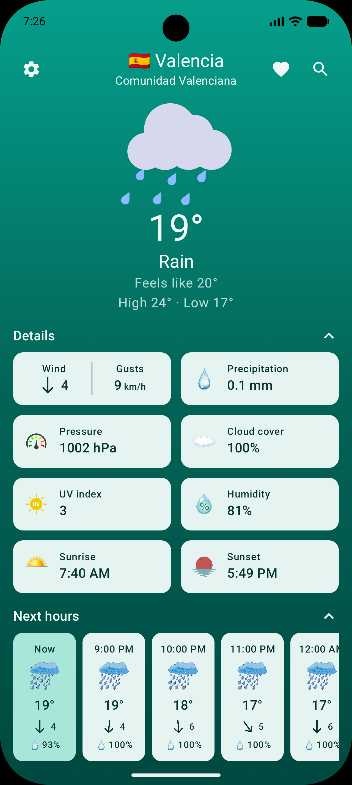 |

---

## 🧩 Widget

WearMet incluye un widget de pantalla de inicio que muestra el tiempo de tu localidad preferida (o, si no hay, la última consultada).

- Dos tamaños adaptables (compacto y normal).
- Muestra el nombre del lugar, icono y temperatura actual, máxima y mínima, y viento con rachas y flecha de dirección.
- **Caché local**: si no hay conexión, muestra el último dato guardado y reintenta automáticamente cuando vuelva la red.
- **Actualización periódica** con WorkManager, configurable desde Ajustes.
- Al tocarlo, abre la app directamente en la localidad del widget.

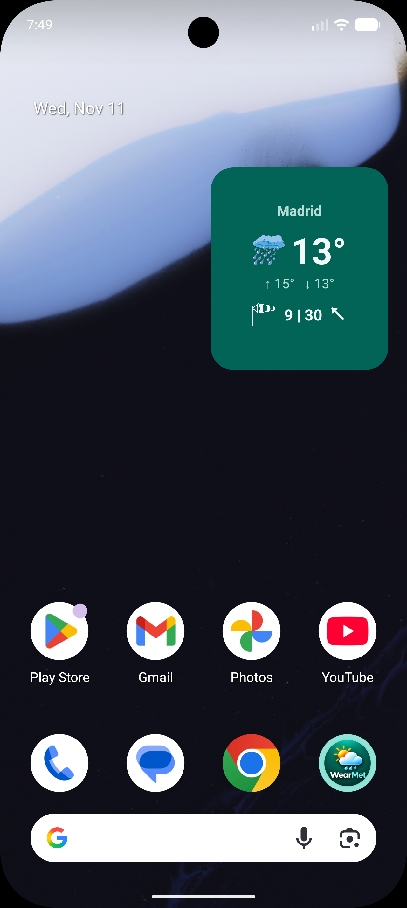

> **Nota:** algunos fabricantes (por ejemplo, capas como ColorOS con ahorro de batería agresivo) pueden retrasar las tareas en segundo plano. Si el widget se actualiza menos de lo esperado, desactiva la optimización de batería para WearMet.

---

## 🌐 Idiomas

La interfaz está traducida y cambia automáticamente según el idioma del sistema.

| Idioma  | Carpeta de recursos         |
| ------- | --------------------------- |
| Español | `res/values/strings.xml`    |
| English | `res/values-en/strings.xml` |

Para añadir otro idioma, crea una carpeta `res/values-<código>/` (por ejemplo `values-fr`) con una copia traducida de `strings.xml`.

---

## 🛠️ Tecnologías

| Área                    | Tecnología                                       |
| ----------------------- | ------------------------------------------------ |
| Lenguaje                | Kotlin                                           |
| UI                      | Jetpack Compose + Material 3                     |
| Navegación              | Navigation 3                                     |
| Widget                  | Jetpack Glance                                   |
| Tareas en segundo plano | WorkManager                                      |
| Red                     | Retrofit + OkHttp + Gson                         |
| Base de datos local     | Room 3 (con KSP) y driver SQLite empaquetado     |
| Preferencias            | DataStore (Preferences)                          |
| Serialización de caché  | kotlinx.serialization                            |
| Animaciones             | Lottie Compose                                   |
| Ubicación               | Google Play Services Location (Fused Location)   |
| Concurrencia            | Corrutinas y Flow                                |
| Compilación             | Android Gradle Plugin 9.x, catálogo de versiones |

---

## 🏗️ Arquitectura

El proyecto sigue una arquitectura por capas con **MVVM**:

```
UI (Compose)  →  ViewModel  →  Repositorio  →  API / Room / DataStore
```

- **`data`**: servicios Retrofit, DTOs y mapeo a modelos de dominio. Los datos incompletos se descartan en el mapeo.
- **`domain`**: modelos (`Weather`, `Location`, etc.) y resultados tipados (`Success`, `NetworkError`, `ServerError`, `UnknownError`).
- **`local`**: Room (favoritos) y DataStore (ajustes y última ubicación).
- **`ui`**: pantallas, componentes, tema y ViewModels con estados explícitos (`Loading`, `Success`, `Error`).
- **`widget`**: widget Glance, carga de estado, caché en JSON y programación de actualizaciones.

---

## 🌍 Fuente de datos y créditos

Los datos meteorológicos y de geolocalización de WearMet los proporciona
**[Open-Meteo](https://open-meteo.com/)**, una API meteorológica de código abierto que ofrece acceso gratuito para uso no comercial. ¡Muchas gracias al equipo de Open-Meteo por hacerlo posible! 💙

- 🌤️ **Previsión**: [`api.open-meteo.com/v1/forecast`](https://open-meteo.com/en/docs)
- 📍 **Búsqueda de ciudades**: [`geocoding-api.open-meteo.com/v1/search`](https://open-meteo.com/en/docs/geocoding-api)
- 📄 **Licencia de los datos**: [Creative Commons Attribution 4.0 (CC BY 4.0)](https://creativecommons.org/licenses/by/4.0/)

> *Weather data by [Open-Meteo.com](https://open-meteo.com/).*

Este proyecto es independiente y **no está afiliado ni respaldado por Open-Meteo**. El uso gratuito de la API está limitado a uso no comercial y a un máximo de peticiones (10 000 al día, 5 000 por hora y 600 por minuto). Consulta sus [términos de uso](https://open-meteo.com/en/terms) antes de distribuir la app con fines comerciales.

---

## 🎨 Créditos de recursos gráficos

### Animaciones (Lottie)

Las animaciones del tiempo proceden de **[LottieFiles](https://lottiefiles.com/)** y son animaciones gratuitas publicadas bajo la [Lottie Simple License](https://lottiefiles.com/page/license), que permite descargarlas, modificarlas y distribuirlas, incluso con fines comerciales. La atribución al autor no es obligatoria, pero sí recomendada. ¡Gracias a sus creadores! 💙

### Iconos e imágenes

Los iconos del tiempo y de detalle (viento, humedad, presión, etc.) se han obtenido de **[PNGWing](https://www.pngwing.com/)**.

> Las imágenes de PNGWing las suben usuarios y cada una puede tener sus propios derechos de autor. Si eres el autor de alguna y quieres que se retire o se acredite de otra forma, abre un *issue* en este repositorio.

---

## 🚀 Instalación y compilación

### Requisitos

- Android Studio (versión reciente compatible con AGP 9.x)
- JDK 17 o superior
- Dispositivo o emulador con Android 9

### Pasos

```bash
# 1. Clona el repositorio
git clone https://github.com/TODO_USUARIO/WearMet.git

# 2. Abre la carpeta en Android Studio y deja que Gradle sincronice

# 3. Ejecuta la app en un dispositivo o emulador (Run ▶)
```

No necesitas ninguna clave de API: Open-Meteo no la requiere para uso no comercial.

### Probar la versión directamente

- Puedes descargar e instalar la APK desde aquí: [Enlace a la APK](https://drive.google.com/file/d/1CjwQfE8FA7-DxTFr11nTJlaaae_1UYPT/view?usp=sharing)

### Generar una versión release

1. Crea tu propio *keystore* (`Build → Generate Signed App Bundle / APK`).
2. **No subas nunca el archivo `.jks` ni sus contraseñas al repositorio.** Añádelos al `.gitignore`.
3. El build release usa R8 para reducir y optimizar el código. Las reglas de conservación están en `app/src/main/keepRules/`.

---

## 🔐 Permisos

| Permiso                                           | Para qué se usa                                                        |
| ------------------------------------------------- | ---------------------------------------------------------------------- |
| `INTERNET`                                        | Consultar la previsión y buscar ciudades.                              |
| `ACCESS_COARSE_LOCATION` / `ACCESS_FINE_LOCATION` | Botón «Buscar por mi ubicación». Solo se piden cuando pulsas el botón. |

La ubicación se usa únicamente para obtener el tiempo de tu zona y no se envía a servidores propios ni se comparte con terceros. Las coordenadas se envían a Open-Meteo para obtener la previsión.

---

## 📂 Estructura del proyecto

```
com.zekiee.wearmet
├── data
│   ├── api            # Retrofit, URLs y variables de Open-Meteo
│   ├── dto            # Modelos de red (Geocoding, Current, Hourly, Daily)
│   ├── repository     # Repositorios de red y proveedor de ubicación
│   └── response       # Respuestas de la API y mapeo a dominio
├── domain
│   ├── model          # Weather, Location, CurrentWeather, ...
│   └── result         # WeatherResult, LocationResult
├── local
│   ├── dao / entity   # Room (favoritos)
│   ├── data           # DataStore (ajustes) y base de datos
│   └── repository     # FavouritesRepository
├── ui
│   ├── components     # Componentes de búsqueda, tiempo y ajustes
│   ├── logicUI        # WeatherCondition, WindArrow
│   ├── navigate       # Rutas y NavHost (Navigation 3)
│   ├── screens        # Splash, Search, Weather, Settings
│   ├── state          # Estados de UI
│   ├── theme          # Colores, tipografía y tema
│   └── viewmodel      # ViewModels
├── widget
│   ├── components     # Piezas del layout Glance
│   ├── screens        # Contenido del widget
│   ├── state          # Estado y carga de datos
│   └── updater        # Caché, scheduler, worker y refresco
└── MainActivity.kt
```

---

## 📜 Licencia

El **código fuente** de WearMet se distribuye bajo la licencia **MIT**. Consulta el archivo [LICENSE](LICENSE).

Esta licencia **no cubre** los datos de Open-Meteo (CC BY 4.0), las animaciones de LottieFiles (Lottie Simple License) ni las imágenes de PNGWing, que mantienen sus propios términos, descritos en las secciones de créditos.

---

## 👤 Autor

Desarrollado por **Ezequiel Tamayo**.
